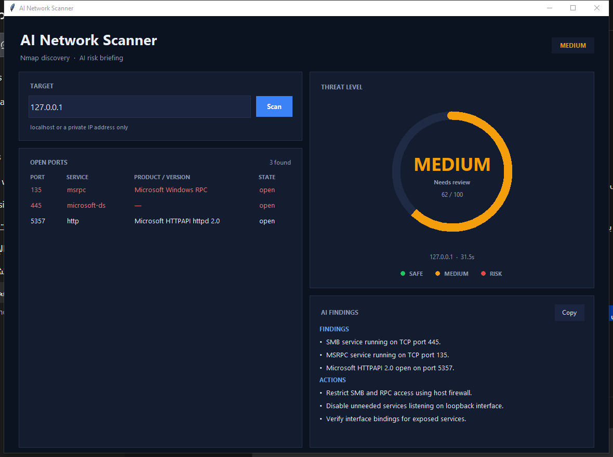

# AI Network Security Scanner 🛡️

A Python tool that scans a host with **Nmap** and turns the raw output into a
short, readable security brief using **Google Gemini** — available as a modern
desktop app **and** a command-line tool.



Point it at `localhost` or a private IP (e.g. `192.168.1.10`) and it will:

1. Discover the top 100 TCP ports and fingerprint the services on them (`-sV`).
2. Send the structured results to Gemini.
3. Show a **circular threat gauge** — green `SAFE` / orange `MEDIUM` / red
   `RISK` — next to a brief of 2–4 findings and 2–4 actions.

> ⚠️ **Authorized use only.** Scan only systems you own or have written
> permission to test. Unauthorized scanning is illegal in most countries.

---

## Features

- 🎛️ **Modern desktop UI** — dark theme, live port table, threat gauge
- 🚦 **Risk gauge** with colour-coded rating and a 0–100 score
- ✂️ **Brief output by design** — the prompt forbids essays, tables and headers
- 🔍 Nmap service/version detection on the 100 most common TCP ports
- 🏁 **Model racing** — four Gemini models run in parallel, the fastest usable
  answer wins, so one overloaded model cannot stall the scan
- 🔐 API key read from the environment — never hardcoded in the source
- 🎯 Target validation that refuses public IPs by design
- 🧪 Headless tests for the UI logic (`test_ui.py`, `test_incomplete.py`)

## Requirements

| Component | Version |
|-----------|---------|
| Python    | 3.10+   |
| Nmap      | 7.90+ (with Npcap on Windows) |
| python-nmap | 0.7.1 |
| google-genai | 1.x |

## Installation

```bash
git clone https://github.com/7ssann/ai-network-scanner.git
cd ai-network-scanner
python -m pip install -r requirements.txt
```

Install Nmap and make sure it is on your `PATH`:

- **Windows** — <https://nmap.org/download.html> (includes Npcap)
- **Debian/Ubuntu** — `sudo apt install nmap`
- **macOS** — `brew install nmap`

Verify both tools:

```bash
nmap --version
python -c "import nmap, google.genai; print('deps ok')"
```

## Configuration

Get a free API key from [Google AI Studio](https://aistudio.google.com/apikey),
then export it as an environment variable.

**Windows (PowerShell)**

```powershell
# current session only
$env:GEMINI_API_KEY = "your-key-here"

# permanently for your user
setx GEMINI_API_KEY "your-key-here"
```

**Linux / macOS**

```bash
export GEMINI_API_KEY="your-key-here"
```

## Usage

### Desktop app

```bash
python app.py
```

Optional — start a scan immediately:

```bash
python app.py 192.168.1.10
```

On Windows you can also double-click `run.cmd`, which loads the key from your
user environment and then starts the scanner.

### Command line

```bash
python Ai_scan.py
python Ai_scan.py 192.168.1.10
```

### Example brief

```
RISK: MEDIUM    (model: gemini-3.5-flash)

FINDINGS:
- SMB service running on TCP port 445.
- MSRPC service running on TCP port 135.
- Microsoft HTTPAPI 2.0 open on port 5357.
ACTIONS:
- Restrict SMB and RPC access using host firewall.
- Disable unneeded services listening on loopback interface.
- Verify interface bindings for exposed services.
```

## Project layout

| File | Purpose |
|------|---------|
| `scanner.py` | Core engine: validation, Nmap scan, Gemini analysis, risk rating |
| `app.py` | Desktop UI (Tkinter) with the threat gauge |
| `Ai_scan.py` | Command-line interface |
| `run.cmd` | Windows launcher for the desktop app |
| `test_ui.py` | Headless checks of the UI state and colour mapping |
| `test_incomplete.py` | Guards that a timed-out scan is never reported as SAFE |

## How it works

```
 target input ──► get_target()          validate: loopback / private IP only
                      │
                      ▼
                 scan_ports()           nmap -sV -T4 --top-ports 100
                      │                 --max-retries 2 --host-timeout 120s
                      ▼
                  analyze()             Gemini: 4 models raced in parallel
                      │                 → RISK line + short bullets
                      ▼
            gauge + port table + brief
```

### Risk rating

| Level | Colour | Meaning |
|-------|--------|---------|
| `SAFE` | 🟢 Green | No risky service exposed |
| `MEDIUM` | 🟠 Orange | Exposed services need review |
| `RISK` | 🔴 Red | Dangerous exposure detected |

The rating comes from the model's `RISK:` line. If every model is unavailable,
the tool falls back to a local heuristic and says so explicitly.

## Design decisions

- **A timed-out scan is never "clean".** If Nmap hits the host timeout without
  usable port data, the UI reports an error instead of `SAFE`.
- **The AI is not allowed to invent.** The prompt forbids CVE IDs, version
  numbers and dates that are absent from the scan data.
- **No keys in Git.** The API key is read from `GEMINI_API_KEY`; `.gitignore`
  blocks `.env` files and scan output.

## Limitations

- TCP only, and only the top 100 ports — not a full port sweep or UDP scan.
- `-sV` fingerprints banners; it is **not** a vulnerability scanner. An open
  port is not a vulnerability, and the brief says so explicitly.
- Public hosts are rejected except `scanme.nmap.org`, the test host published
  by the Nmap project.
- The AI output is advisory. Always verify findings manually.

## Legal

This tool is built for lab use and self-assessment. You are responsible for
staying inside the law and inside your authorization scope.

## License

MIT — see [LICENSE](LICENSE).

---

## نظرة عامة (بالعربي)

أداة بلغة Python تفحص جهازًا أو شبكة داخلية باستخدام **Nmap** (أشهر 100 منفذ
TCP مع كشف الخدمة والإصدار)، ثم ترسل النتيجة إلى **Gemini** لتحصل على تقرير
أمني قصير: دائرة خطورة ملوّنة، جدول المنافذ، وملاحظات وتوصيات مختصرة.

**واجهة رسومية:**

```powershell
python app.py
```

**سطر أوامر:**

```powershell
python Ai_scan.py 192.168.1.10
```

**مهم:** تُستخدم الأداة فقط على الأجهزة التي تملكها أو لديك تصريح صريح بفحصها.
